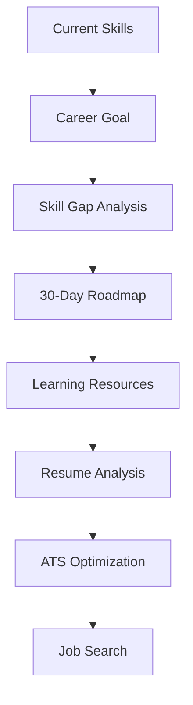

# CareerPilot AI

CareerPilot AI is a professional AI-powered career guidance and resume intelligence platform built with Flask, JSON persistence, and Google Gemini integration. It connects career planning and resume optimization in one experience.

## Project Overview

This portfolio project helps students and job seekers move from current skills to target roles using a guided workflow that includes:

- Skill gap analysis
- Personalized 30-day roadmap
- Learning resource recommendations
- Resume analysis and ATS guidance
- Job-search suggestions
- Interview-prep support

## Problem Statement

Many learners struggle with choosing the right career path, identifying the gaps between current skills and target roles, and turning their resume into a stronger application. Career guidance and resume improvement are often disconnected.

## Solution

CareerPilot AI provides a connected career and resume workflow so the user can plan, improve, and apply with greater clarity.

## Key Features

- AI career guidance
- Personalized 30-day roadmap
- Skill gap radar visualization
- Resume ATS estimation
- Resume upgrade recommendations
- Job search hub
- Interview preparation
- Demo mode when Gemini is not configured
- JSON file persistence

## Unique Features

- Career + resume connection using the same target role and roadmap
- Skill gap radar built with SVG
- Career readiness score dashboard
- Curated resource catalog with validated external links
- Floating AI assistant

## Technology Stack

- Frontend: HTML5, CSS3, JavaScript
- Backend: Python, Flask
- AI: Google Gemini API
- Storage: JSON files
- Parsing: PyPDF2, python-docx

## Architecture

The project uses Flask route modules, service modules, and a reusable JSON storage layer. The app keeps all key record data in the data folder instead of a database.

## Installation

```bash
python -m venv venv
source venv/bin/activate
pip install -r requirements.txt
```

On Windows, use:

```powershell
venv\Scripts\activate
pip install -r requirements.txt
```

## Environment Variables

Create a `.env` file with:

```env
GEMINI_API_KEY=your_key_here
GEMINI_MODEL=gemini-2.5-flash
```

## How to Run

```bash
python app.py
```

Then open:

```text
http://localhost:5000
```

## API Endpoints

- GET /api/health
- POST /api/career/analyze
- GET /api/career/profile
- PUT /api/career/profile
- GET /api/career/roadmap
- PUT /api/career/roadmap/progress
- POST /api/resume/upload
- POST /api/resume/analyze
- GET /api/resume/history
- GET /api/resume/analysis/<id>
- GET /api/resources
- GET /api/resources/<category>
- GET /api/jobs/search-links
- POST /api/interview/generate

## Demo Mode

If the Gemini API key is missing, the app displays demo data with clear labeling instead of crashing.

## Gemini API Setup

1. Create a Google AI Studio account.
2. Generate an API key.
3. Add it to `.env`.
4. Restart Flask.

## Workflow Diagram



## Troubleshooting

- Invalid API key: verify the value in `.env`.
- Rate limit: wait and retry.
- Missing file: verify upload format and size.
- Demo mode: connect the Gemini key for live AI output.

## Future Improvements

- Skill-tracking dashboard
- Real portfolio integration
- More advanced ATS logic
- Personalized email cover letter generator
